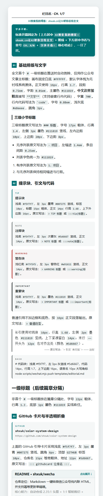
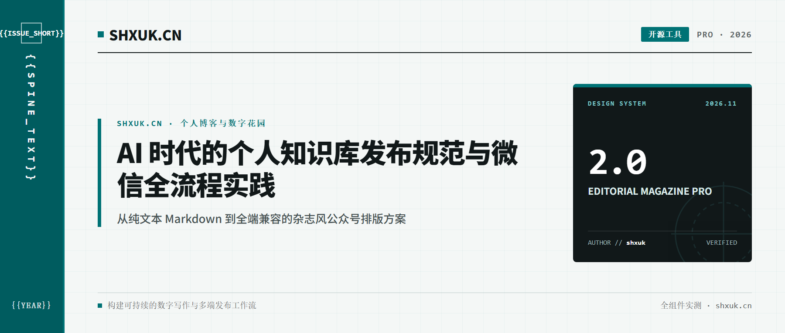

# wechat-article-publisher

[简体中文](./README.md) | English

Publishing Markdown articles to a WeChat Official Account (微信公众号) is notoriously tedious: pasted formatting breaks, JavaScript is stripped (breaking interactive toggles), cover images need manual text overlays every time, and re-uploading after fixing a typo creates duplicate drafts.

This tool & AI Agent Skill automates the entire pipeline while keeping your source Markdown **strictly read-only**:
1. **Editorial Magazine 2.0 components**: supports canonical kicker header bars (`::: kicker`), bold lead takeaways (`::: lead`), mobile-friendly metrics (`::: metrics`), side-by-side comparison cards (`::: versus`), verdict cards (`::: verdict`), and structured Q&A (`::: qa`).
2. **Dual-layer SVG translucent preview fold & GitHub cards**: supports `::: details` translucent gradient preview folds (no redundant header bar, full-block click to expand, bottom-right button to collapse, zero modal popup), `::: githubcard`, and `::: follow` author cards.
3. **Automated cover generation & 1:1 smart crop**: renders a 2.35:1 (1800×766) cover image via headless Chrome/Edge from `templates/template-*.html` (including Template-D Pro Editorial & Template-E 3D Geometric Bookshelf styles), injecting WeChat 1:1 square crop coordinates automatically to preserve branding without truncation.
4. **Idempotent draft publishing**: uploads local images to WeChat's media library with hash caching, and updates the existing draft (`media_id`) on repeated pushes.

---

## Visual Showcase

<div align="center">
  
</div>

<div align="center">
  
</div>

---

## Quick Start

```bash
# 1. Install dependencies (pure native lightweight markdown-it + juice engine)
pnpm install

# 2. Generate local HTML preview from the standard template (offline)
node scripts/wechat.mjs gen templates/editorial.md
```

Outputs are written to `~/.wechat-article/work/<slug>/` (configurable via `WECHAT_WORK_DIR`):
- `body.html`: final WeChat-ready inline HTML
- `layout.json`: line-by-line rule match report
- `meta.json`: extracted title, cover, and SVG metadata

### Push to WeChat Drafts

```bash
cp .env.example .env
# Fill in WECHAT_APP_ID and WECHAT_APP_SECRET, then:
node scripts/wechat.mjs push path/to/your-post.md
```

---

## How It Works

1. **Fixed template expansion**: parses Markdown according to `templates/editorial.md` — converting every `##` heading into a `01` teal square tab, `###` into a left-bordered subheading, plus callouts (`TIP`/`NOTE`/`WARNING`/`IMPORTANT`), `::: githubcard`, `::: details` translucent preview folds, and attributed quotes.
2. **Inline CSS rendering**: uses `juice` with `assets/theme.css` to inline all styles directly and patches SVG height attributes so `focusin`/`focusout` animations work natively inside WeChat.
3. **Cover compositing & smart crop**: renders `templates/template-*.html` at 1800×766 via Chrome (with automatic Edge fallback) and auto-injects WeChat 1:1 square crop coordinates focusing on the right spec card to avoid cutting off titles.
4. **Media & draft sync**: uploads local images once (cached by content hash) and creates or updates the draft via the Official Account API.

---

## Repository Layout

- `scripts/wechat.mjs`: main CLI (`gen` / `push`)
- `components/`: `cards.mjs` (cards, callouts, quotes, code blocks) and `svg-fold.mjs` (dual-layer SVG translucent preview fold)
- `assets/`: `theme.css`, default cover/base images
- `templates/`: `editorial.md` (canonical template & visual spec) and cover HTML templates (`template-a/b/c.html`)
- `docs/`: visual specs and historical references
- `SKILL.md`: AI Agent Skill specification
