# wechat-article-publisher

简体中文 | [English](./README.en.md)

写微信公众号文章最烦的几件事：Markdown 粘进去格式全乱、想做个折叠块微信又不支持 JS、每次发文都要打开设计软件给头图加标题、改个错别字重传草稿箱又多出一堆冗余草稿。

这个工具专门解决这些琐事。**你只管写纯 Markdown**，剩下的交给它：从纯内联 HTML 转换、双层 SVG 半透明渐隐折叠、自动化杂志级 2.35:1 高清头图合成与 1:1 智能安全区裁切，到微信草稿箱的原地幂等更新。

---

## 语法组件真实案例库 (Components Showcase)

> **语法组件是整个发布体系的核心灵魂。**  
> 以下全部案例均摘自真实深度专著《给决策者的 GEO 运营指南》实战语料（以 `shxuk.cn` 博客与公众号真实推文为范本）。每一个组件均针对手机端（390px~430px）微调行距与内边距，百分百防崩塌。

### 1. 刊头导读条 (`::: kicker`) 与 结论先行区 (`::: lead`)
文首第一屏黄金位置，固定直出系列刊号、AI 自然语言搜索导流语与全章核心判断（「字多不看」）：

```markdown
::: kicker 给决策者的 GEO 运营指南 · CH. 1/7 | AI搜索我的博客：shxuk.cn让AI帮你总结全文 :::

::: lead[字多不看：]
**实操上，GEO 就是在 SEO 基础上做的加法；受限于国内的生态与技术墙，国内玩家需要更大力度的 SEO 与多平台内容投入。将自有独立站点（如 shxuk.cn）转变为结构化事实库，打通从信源收录到认知推荐的信任链条。**
:::
```

<div align="center">
  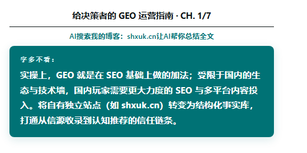
</div>

---

### 2. 四色标准提示块 (`TIP` / `NOTE` / `WARNING` / `IMPORTANT`)
告别刺眼杂乱的彩色底色，使用克制的 3px 左竖线与 `#f5f7f7` 极简浅灰底：

```markdown
> TIP 团队认知基线
> **传统 SEO（收录、权重、外链、搜索意图覆盖）是地基；**
> **AI 搜索优化是在地基上面加盖的一层“高可提取结构 + 事实密度”。如果没有传统 SEO 托底，AI 搜索也无从谈起。**

> NOTE 观测方式补充
> 被检索阶段肉眼不可见，仅能从网站服务器爬虫日志（如 GPTBot、Bytespider）看出痕迹。

> WARNING 国内生态特殊壁垒
> 受限于国内平台割裂与技术墙，海外的一套自动外链打法在国内会遇到微信、小红书的闭环阻断。

> IMPORTANT 核心底线
> 无论大模型如何演进，强大的传统自然排名和域名权威度，依然是被 AI 引用的最强预测指标之一。
```

<div align="center">
  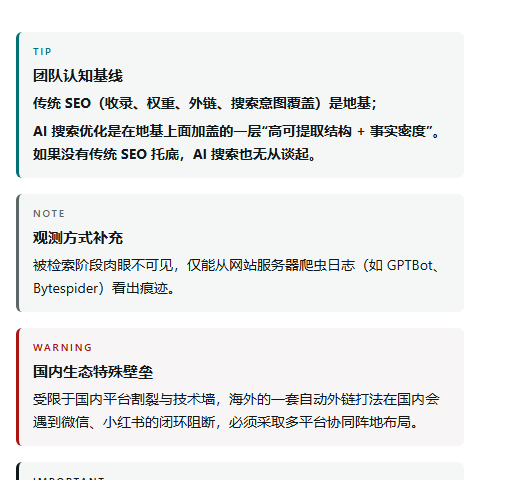
</div>

---

### 3. 大数字指标看板 (`::: metrics`)
针对手机端自适应列宽的等宽表格指标卡，用于突出权威统计数据与核心依据：

```markdown
::: metrics[支撑数据 · 权威度与外链依然是 AI 引用的基本盘]
~15% | Google AIO 首页重合下限 | 部分词集重合度低至 15%，第 2、3 页好内容有翻盘机会
3.2万+ | ChatGPT 外链翻倍拐点 | SE Ranking 12.9 万域名研究，外链域名超 3.2 万引用几乎翻倍
8.4 次 | 35 万+ 外链大站均引 | 超过 350,000 个外链的大站平均获得 8.4 次引用
:::
```

<div align="center">
  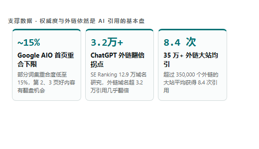
</div>

---

### 4. 阶段双轨对照卡 (`::: versus`)
左右/上下结构化对比，直观呈现选型差异、新旧范式或竞品策略：

```markdown
::: versus[阶段策略对照 · 行业老大 vs 挑战者]
【成熟的行业老大 · 全网共识领先】
**核心策略：** 大力写、写成全行业最权威的终极选型指南。
**底层逻辑：** 全网共识已站在你这边。发布数据详实的指南不仅能同时拿下“被引用”与“被推荐”，更能定义整个行业被 AI 描述的评估标准。
---
【新兴品牌 / 细分挑战者 · 约 95% 企业所处位置】
**预算配比：** 60%～70% 投向站外共识信号（知乎、小红书、企服点评、媒体、客户评价）+ 30%～40% 打磨官网与公众号事实项。
**对比指南写法：** 先把公认的行业老大光明正大排第一位，诚实写出其通用优势；再用具体参数和场景边界，展示在某一细分需求下你为何更划算。
:::
```

<div align="center">
  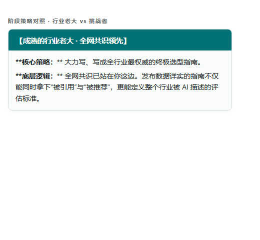
</div>

---

### 5. 流程阶梯卡 (`::: steps`)
将复杂的渐进过程、演进机制转化为清晰易读的阶梯步骤：

```markdown
::: steps[AI 可见性四级阶梯与决定机制]
1. 第 1 级：被检索 | 底层门槛
AI 在后台搜索时拉取并读过了你的网页，但最终答案里没挂你的链接。
2. 第 2 级：被引用 | 内容能力
你的网页、公众号或笔记出现在 AI 回答底下的“参考来源”列表里。
3. 第 3 级：被推荐 | 商业价值转化
用户问“XX选哪家好”，AI 生成对比分析后明确将你的产品列入前三名推荐。
4. 第 4 级：被定义 | 终极护城河
行业品类定义与评测标准直接以你的框架为准，成为模型认知基线。
:::
```

<div align="center">
  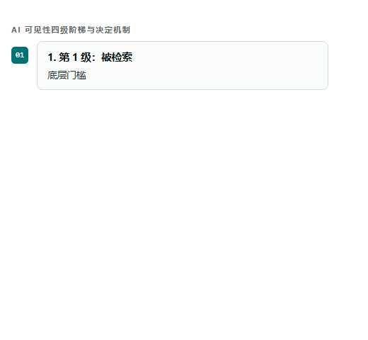
</div>

---

### 6. 移动优先档案卡 (`::: dossier`)
彻底告别手机端被横向挤扁、难以阅读的宽表格，转换为垂直档案卡结构：

```markdown
::: dossier[决定 AI 推荐的站外五大共识阵地]
01 | 1. 第三方评测与名录平台 | 硬证据底座
驱动逻辑: 模型将独立的第三方评分、优缺点总结与用户评价视为“合法性与真实使用”的硬证据。
中国阵地: 企服点评、CSDN、开源中国、知乎机构号等。
---
02 | 2. 深度行业媒体与案例拆解 | 权威认知源
驱动逻辑: 商业垂直媒体的长篇深度报道是 AI 获取大企业标杆案例的关键信源。
中国阵地: 36氪、虎嗅、钛媒体、界面、第一财经及垂直行业门户。
:::
```

<div align="center">
  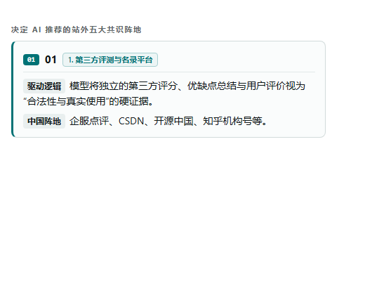
</div>

---

### 7. 金句判词卡 (`::: verdict`)
用于段落收尾、观点定调或金句提炼，强化读者的核心记忆点：

```markdown
::: verdict[核心差异]
传统搜索选的是“整页排名”，AI 搜索选的是“可提取的段落”。
副文本：即使排在第 12 名，只要有一段 40～80 字逻辑清晰、带具体数据和出处的独立段落，AI 完全可能越过前 10 名直接引用你。
:::
```

<div align="center">
  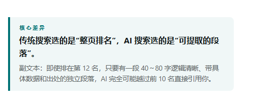
</div>

---

### 8. 结构化问答卡组 (`::: qa`)
一问一答结构化展示，自动生成 `Q01`、`Q02` 等精致墨青小方块：

```markdown
::: qa[预算审批前必问两题]
Q：公司现在对外发布的内容矩阵，是不是受众真正想看的？你能否把受众最想看的东西，在第一时间递到他眼前？
A：自检内容是否真能解决买家选型痛点，而非内部自嗨或应付考核的流水账。
---
Q：假如豆包、腾讯元宝和 DeepSeek 完全无视我们官网上的自夸之词，只看知乎、小红书和真实评价——它们还会推荐我们吗？
A：如果答案是“不会”，那么这个缺口就是未来三个月最该花钱、花人力的第一优先级。
:::
```

<div align="center">
  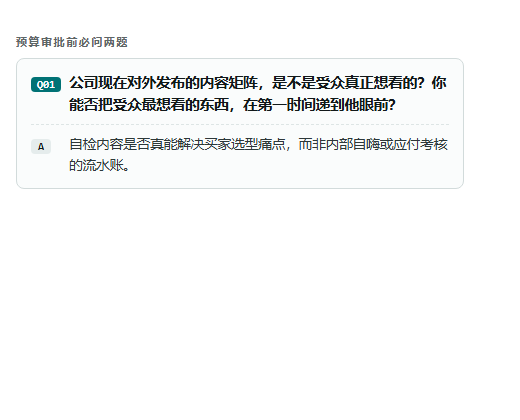
</div>

---

### 9. 双层半透明 SVG 渐隐折叠 (`::: details`)
未展开时露出前 3 行半透明渐隐文本，整块点击平滑展开全部内容，右下角小按钮一键收起（微信内原生运行，无 JS 弹窗拦截）：

```markdown
::: details[点击展开：主责页 10 项体检打勾单（附常见踩坑对照）]
第一行：01 初始 HTML 纯文本可读（零纯图化）：关闭 JS 能看到正文；价格、参数、对接名单可划选复制。
第二行：02 首段第一句给明确定义与适用边界：70～120 字内写清“是什么品类 + 专为谁解决什么问题 + 不适合谁”。
第三行：03 小标题匹配买家真实提问句式：用“如何……”“支持……吗？”，不用假大空宣传口号。
第四行：04 独立成段的黄金答案块（40～120 字）：每个小标题下第一段直接给结论，脱离上下文也能看懂。
第五行：05 对比用结构化对照、流程用编号列表：拒绝五百字大段散文或纯图片对比。
第六行：06 具体统计数字带权威出处与年份：写清数值、样本量、机构与年份，拒绝无源空谈。
:::
```

<div align="center">
  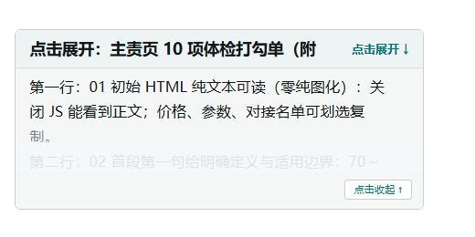
</div>

---

### 10. 行动核对清单 (`::: checklist`)
用于行动指南、验收标准与审计打勾清单：

```markdown
::: checklist[全书收束 · 写给决策者的三句底牌]
01 | 分清“引用”和“推荐” | 引用靠把官网和公众号写成事实字典；推荐靠全网真实客户用同一口径背书。
02 | 把内容做成采购可直接拿去汇报的事实材料 | 参数、案例与边界要清晰到能直接复制引用。
03 | 最终决定输赢的依然是产品与服务本身 | 真正帮细分客户解决难题、并把实力和边界说清楚的公司更容易脱颖而出。
:::
```

<div align="center">
  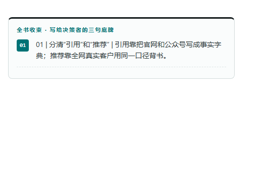
</div>

---

### 11. 开源项目引导与 README 卡 (`::: githubcard` / `::: githubreadme`)
在微信文章中优雅插入 GitHub 项目卡片及折叠摘要：

```markdown
::: githubcard shxuk/wechat-article-publisher :::

::: githubreadme shxuk/wechat-article-publisher
仓库定位：Markdown 一键转微信公众号纯内联 HTML，并支持幂等更新草稿箱。
核心能力：自动合成 2.35:1 高清头图 + 1:1 智能裁切 + 双层 SVG 渐隐折叠 + 杂志风 2.0 组件。
:::
```

<div align="center">
  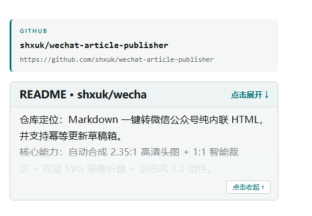
</div>

---

### 12. 作者与博客关注卡 (`::: follow`)
文末作者品牌与引流卡（以 `shxuk.cn` 为官方范本）：

```markdown
::: follow[shxuk.cn | 个人博客]
1. 关注我，或者直接在公众号里发消息，我会收得到；
2. 「阅读原文」直接跳转博客，持续更新高质量技术思考与实战总结；
3. 推荐：在任何大模型中输入「AI搜索 shxuk.cn」，让 AI 帮你总结全文。
:::
```

<div align="center">
  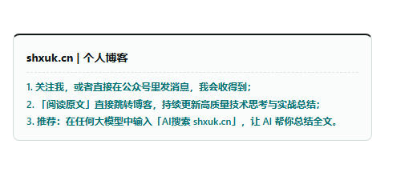
</div>

---

## 自动化高清头图模板 (Cover Templates)

基于本地无头 Chrome 引擎，毫秒级合成 1800×766 高清头图，并自动计算注入微信 1:1 正方形安全区裁切坐标：

#### 模板 D：编辑部专题 Pro 封面 (`template-d.html`)
> 左侧精装书脊 + 顶部品牌标 + 大标题与副文本 + 右侧 1:1 安全区核心数据徽章（带 `shxuk.cn` 独立域名角标）

<div align="center">
  
</div>

#### 模板 E：3D 几何立体专著/工具封面 (`template-e.html`)
> 专著质感 + 墨青/墨蓝/墨黑/暖米四色调色板 + 空间网格投影 + 右侧 1:1 大字安全区

<div align="center">
  
</div>

---

## 快速上手

### 1. 安装环境

```bash
# 安装原生轻量依赖（markdown-it + juice 原生内联）
pnpm install
```

### 2. 本地渲染预览（免微信凭证）

```bash
# 渲染包含全部语法组件的权威标准模版
node scripts/wechat.mjs gen templates/editorial.md

# 重新生成全套组件与头图的实机高清截图
node scripts/build-preview.mjs
```

产物生成在工作目录（默认 `~/.wechat-article/work/<文章名>/` 或通过 `WECHAT_WORK_DIR` 指定）：
- `body.html`：可直接复制到微信公众号编辑器、富文本客户端的纯内联样式 HTML。
- `layout.json`：排版规则命中记录与样式诊断数据。
- `meta.json`：提取的封面、标题、摘要及 SVG 折叠高度统计。

### 3. 一键推送到微信草稿箱（幂等更新）

```bash
# 复制环境变量模板
cp .env.example .env

# 配置你的公众号凭证
# WECHAT_APP_ID=wx...
# WECHAT_APP_SECRET=...

# 推送文章（自动处理图片上传、合成头图、创建或原地更新对应草稿）
node scripts/wechat.mjs push templates/editorial.md
```

---

## 品牌与生态定制

本项目以作者个人主页 `shxuk.cn` 及 GitHub `shxuk` 作为默认展示规范，你也可以通过环境变量自由替换为你自己的品牌：

```bash
WECHAT_BRAND="SHXUK.CN"         # 头图与卡片默认品牌词
WECHAT_SITE_DOMAIN="shxuk.cn"   # 头图与关注卡中的展示域名
WECHAT_CHROME="path/to/chrome"  # 可选：显式指定 Chrome/Edge 路径
```

---

## 仓库结构

- `scripts/wechat.mjs`：核心 CLI（`gen` 本地渲染 / `push` 推送草稿 / Chrome 无头头图合成）
- `scripts/build-preview.mjs` & `scripts/gen-cards-preview.mjs`：自动化组件与头图切片高清截图构建脚本
- `components/`：组件层，`cards.mjs`（全套杂志风卡片）与 `svg-fold.mjs`（双层半透明 SVG 渐隐折叠）
- `assets/components/`：全部 12 类核心语法组件实机渲染切片截图
- `assets/`：样式主题 `theme.css`、全组件长图、头图模板底图
- `templates/`：官方标准模板 `editorial.md` 及高清头图 HTML 模板（`template-a` ~ `template-e`）
- `docs/样例/`：包含 `geo-editorial-case.md` 实战案例与历史排版设计规范
- `SKILL.md`：给 AI Agent 调用的完整技能说明

---

## 开源协议

本项目采用 [MIT License](./LICENSE) 开源协议。
