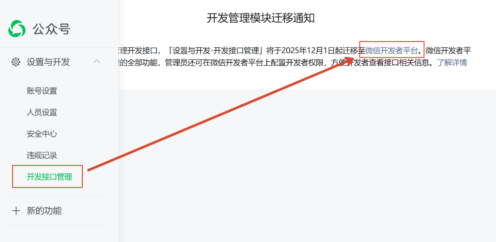
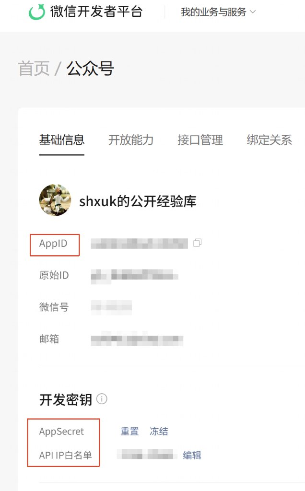

# wechat-article-publisher

写微信公众号文章最烦的几件事：是排版和上传公众号草稿箱。

有时排版比写文章还要费时间。

这个项目可以把你的文章，直接推送到你的微信公众号的草稿箱中。按作者实际感受，写2-3篇稿子基本就可以完成最终的调试。

格式粘进去很容易乱，用135、秀米等工具全乱、折叠块微信不支持 JS、改个错别字草稿箱又多一份重复草稿。这个工具就是给 AI Agent 准备的微信公众号发布利器。

---

## 核心功能

### 功能一：文字发给 AI，直接上传微信草稿箱

把写好的文字复制给豆包工作、千问GO、workbuddy之类的任何 AI 工具，AI 会调用此工具直接完成图文内联渲染，并一键推送到微信公众号的草稿箱；


#### 微信后台配置（仅需一次）

1. 登录微信公众平台，在左侧菜单进入「设置与开发」->「开发接口管理」，点击页面通知跳转至**微信开发者平台**：

<div align="center">
  
</div>

2. 在微信开发者平台的「基础信息」中获取 **AppID**，在开发密钥栏获取 **AppSecret**，并点击编辑将当前运行环境的外网出口 IP 添加到 **API IP白名单** 中：

<div align="center">
  
</div>

> 配置环境变量 `WECHAT_APP_ID` 与 `WECHAT_APP_SECRET` 后，AI 工具即可全自动直通草稿箱。

---

### 功能二：告别丑排版，让 AI 基于丰富组件自由发挥

你依然只管专注写文章内容。把这个仓库授权给 AI 后，告诉 AI“帮我按组件排版”，它就会自动将你的内容组织成杂志风的专业版式：

你可以让项目阅读你的公众号草稿箱，总结你的自己的偏好。指定你自己的风格。也可以在135、秀米等产品做好排版之后，让项目来总结你的风格。

下面的截图是样例是编辑部风格，所以很素。关于颜色搭配，可以看我另外一个项目shxuk/color-system-design

<div align="center">
  
</div>

#### 标准排版语法规范（供 AI 读取，避免幻觉猜测）

AI 在将纯文字改写排版为公众号 Markdown 时，直接使用以下标准语法块即可：

```markdown
<!-- 1. 刊头导读条：居中系列刊号 + AI 搜索导引 -->
::: kicker 给决策者的 GEO 运营指南 · CH. 1/7 | AI搜索我的博客：shxuk.cn让AI帮你总结全文 :::

<!-- 2. 结论先行区：深底加粗核心论点（字多不看） -->
::: lead[字多不看：]
**实操上，GEO 就是在 SEO 基础上做的加法；将自有独立站点转变为结构化事实库，打通从信源收录到认知推荐的信任链条。**
:::

<!-- 3. 数字二级标题：自动渲染为墨青方块数字双栏标题 -->
## 01 为什么传统 SEO 还要继续做

<!-- 4. 四色标准提示块：左边线浅底色 -->
> TIP 团队认知基线
> 传统 SEO 是地基；AI 搜索优化是在地基上加盖的结构层。

> NOTE 补充说明
> 仅能从服务器爬虫日志中观察到痕迹。

> WARNING 风险警告
> 避免在未配置白名单的服务器上直接触发推送。

> IMPORTANT 核心底线
> 域名权威度依然是被 AI 引用的核心预测指标。

<!-- 5. 大数字指标卡：等宽表格列出核心数据 -->
::: metrics[支撑数据 · 权威度与外链依然是 AI 引用的基本盘]
~15% | 首页重合下限 | 部分词集重合度低至 15%，好内容有翻盘机会
3.2万+ | 外链翻倍拐点 | 外链域名超 3.2 万引用几乎翻倍
8.4 次 | 大站平均引用 | 超过 350,000 个外链的大站平均获得 8.4 次引用
:::

<!-- 6. 双轨对照卡：对比方案/竞品差异，用 --- 分隔两轨 -->
::: versus[阶段策略对照 · 行业老大 vs 挑战者]
成熟的行业老大 | 全网共识领先
核心策略：大力写成全行业最权威的终极选型指南。
底层逻辑：全网共识已站在你这边，定义行业评估标准。
---
新兴品牌 / 挑战者 | 约 95% 企业所处位置
预算配比：60%～70% 投向站外共识信号 + 30%～40% 打磨官网。
对比写法：先写老大通用优势，再用具体参数展示细分性价比。
:::

<!-- 7. 流程阶梯卡：阶梯式步骤展示 -->
::: steps[AI 可见性四级阶梯与决定机制]
1. 第 1 级：被检索 | 底层门槛
AI 在后台搜索时读过你的网页，但答案里未挂链接。
2. 第 2 级：被引用 | 内容能力
你的文章出现在 AI 回答底下的参考来源列表里。
3. 第 3 级：被推荐 | 商业转化
AI 明确将你的产品列入前三名推荐。
4. 第 4 级：被定义 | 终极护城河
行业品类评测标准直接以你的框架为准。
:::

<!-- 8. 移动优先档案卡：替代手机端挤扁的宽表格，用 --- 分隔卡片 -->
::: dossier[决定 AI 推荐的站外五大共识阵地]
01 | 第三方评测与名录平台 | 硬证据底座
驱动逻辑: 独立评分与评价是模型视作真实使用的硬证据。
国内阵地: 企服点评、CSDN、开源中国、知乎机构号。
---
02 | 深度行业媒体与案例拆解 | 权威认知源
驱动逻辑: 垂直媒体长篇报道是模型获取企业标杆案例的关键信源。
国内阵地: 36氪、虎嗅、钛媒体、界面、第一财经。
:::

<!-- 9. 金句判词卡：段落收口与核心观点定调 -->
::: verdict[核心差异]
传统搜索选的是“整页排名”，AI 搜索选的是“可提取的段落”。
副文本：哪怕排在第 12 名，只要有 40～80 字逻辑清晰的段落，AI 完全可能直接引用你。
:::

<!-- 10. 问答卡组：一问一答结构化展示，用 --- 分隔题目 -->
::: qa[预算审批前必问两题]
Q：公司现在发布的内容，是不是受众真正想看的？
A：自检内容是否能解决买家选型痛点，而非内部自嗨的流水账。
---
Q：假如模型完全无视自夸之词，只看真实评价——它还会推荐我们吗？
A：如果答案是不会，那这个缺口就是未来三个月最该补足的第一优先级。
:::

<!-- 11. 双层半透明 SVG 渐隐折叠：原生微信内展开收起，无弹窗 -->
::: details[点击展开：主责页 10 项体检打勾单]
第一行：01 初始 HTML 纯文本可读（零纯图化）：关闭 JS 能看到正文。
第二行：02 首段第一句给明确定义与适用边界：70～120 字内写清品类与痛点。
第三行：03 小标题匹配买家真实提问句式：不用空泛口号。
第四行：04 独立成段的黄金答案块：每个小标题第一段直接给结论。
:::

<!-- 12. 行动核对清单：带方块编号的打勾清单 -->
::: checklist[全书收束 · 写给决策者的三句底牌]
01 | 分清引用和推荐 | 引用靠把官网写成事实字典；推荐靠全网客户同一口径背书。
02 | 把内容做成采购可直接汇报的素材 | 参数与边界要清晰到能直接复制引用。
03 | 最终决定输赢的依然是产品本身 | 帮客户解决难题并把边界说清楚的公司更容易胜出。
:::

<!-- 13. GitHub 仓库卡片 -->
::: githubcard shxuk/wechat-article-publisher :::

<!-- 14. 文末作者关注与引流卡 -->
::: follow[shxuk.cn | 个人博客]
1. 关注我，或者直接在公众号里发消息，我会收得到；
2. 「阅读原文」直接跳转博客，持续更新高质量技术思考与实战总结；
3. 推荐：在任何大模型中输入「AI搜索 shxuk.cn」，让 AI 帮你总结全文。
:::
```

> **关于公众号头图**：目前项目内置了封面生成，但是作者不太满意以后会改。

---

## 如何安装与使用

让 AI 查一下这个仓库并安装。

---

## 仓库结构

```text
wechat-article-publisher/
├── assets/                  # 样式与预览资产
│   ├── theme.css            # 微信内联核心样式表
│   ├── wechat-dev-step1.png # 微信公众平台迁移指引截图
│   ├── wechat-dev-step2.jpg # 开发者平台 AppID 与白名单配置截图
│   ├── components/          # 12 组核心语法组件实机高清截图
│   └── preview-components.png # 移动端全组件长图预览
├── components/              # 组件解析逻辑
│   ├── cards.mjs            # 杂志风卡片、提示块与结构化语法渲染
│   └── svg-fold.mjs         # 原生双层半透明 SVG 渐隐折叠实现
├── templates/               # 排版与头图模板
│   ├── editorial.md         # 全组件真实语料标准范例文档
│   └── template-*.html      # 自动化头图合成 HTML 模板
├── docs/                    # 规范与案例
│   └── 样例/                # 真实排版长文样例
├── scripts/                 # 核心执行脚本
│   ├── wechat.mjs           # 核心 CLI（本地编译 gen / 微信草稿推送 push）
│   └── build-preview.mjs    # 本地 Chrome 无头自动化跑图脚本
├── SKILL.md                 # 供 AI Agent 直接读取的技能规范文件
└── package.json             # 轻量级依赖定义（仅 markdown-it + juice）
```

---

## License

[MIT License](./LICENSE)
