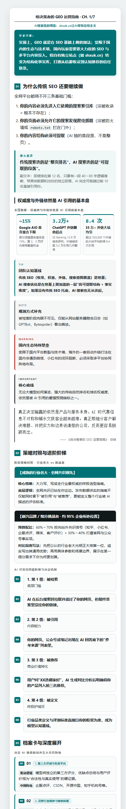

# wechat-article-publisher

写微信公众号文章最烦的几件事：格式粘进去全乱、折叠块微信不支持 JS、改个错别字草稿箱又多一份重复草稿。这个工具就是给 AI Agent 准备的微信公众号发布利器。

---

## 核心功能

### 功能一：文字丢给 AI，直发微信草稿箱

把写好的文字复制给豆包、Cursor、Antigravity 或任何 AI 工具，AI 会调用此工具直接完成图文内联渲染，并一键推送到微信公众号的草稿箱，多次推送同一篇自动原地覆盖，绝不产生重复垃圾草稿。

> **微信后台配置注意**：需要在「微信公众平台」->「设置与开发」->「基本配置」中获取 `AppID` 和 `AppSecret`，并务必将你当前机器的外网出口 IP 添加到 **IP 白名单** 中，否则微信接口会拦截报错。

---

### 功能二：告别丑排版，让 AI 基于丰富组件自由发挥

你依然只管专注写文章内容。把这个仓库授权给 AI 后，告诉 AI“帮我按组件排版”，它就会自动将你的内容组织成杂志风的专业版式：

<div align="center">
  
</div>

内置组件一览：
- **刊头与导语** (`kicker` / `lead`)：栏目名、AI 搜索导引与文首结论先行（字多不看）。
- **四色标准提示块** (`TIP` / `NOTE` / `WARNING` / `IMPORTANT`)：克制耐看的深浅配色。
- **大数字指标卡** (`metrics`)：移动端等宽自适应数据看板。
- **双轨对照卡** (`versus`)：方案对比、竞品对比、优缺点清晰分栏。
- **流程阶梯卡** (`steps`) 与 **档案卡** (`dossier`)：拯救手机端被挤压变形的大表格。
- **金句判词** (`verdict`) 与 **问答组** (`qa`)：观点收口与一问一答 Q&A 模块。
- **双层半透明 SVG 渐隐折叠** (`details`)：原生 SVG 折叠，露出前 3 行渐隐预览，点击展开，无微信弹窗。
- **GitHub 引导卡** (`githubcard`) 与 **作者关注卡** (`follow`)：优雅展示项目与个人品牌。

> **关于公众号头图**：目前项目内置了封面生成模板，但还在开发迭代中，现在看着有点丑，后续会进一步优化和稳定。

---

## 如何安装与使用

让 AI 查一下这个仓库并安装。

---

## 仓库结构

```text
wechat-article-publisher/
├── assets/                  # 样式与预览资产
│   ├── theme.css            # 微信内联核心样式表
│   ├── components/          # 12 组核心语法组件实机高清截图
│   └── preview-components.png # 移动端全组件长图预览
├── components/              # 组件解析逻辑
│   ├── cards.mjs            # 杂志风卡片、提示块与结构化语法渲染
│   └── svg-fold.mjs         # 原生双层半透明 SVG 渐隐折叠实现
├── templates/               # 排版与头图模板
│   ├── editorial.md         # 全组件真实语料标准范例文档
│   └── template-*.html      # 自动化头图合成 HTML 模板
├── docs/                    # 规范与案例
│   └── 样例/                # 真实排版长文样例
├── scripts/                 # 核心执行脚本
│   ├── wechat.mjs           # 核心 CLI（本地编译 gen / 微信草稿推送 push）
│   └── build-preview.mjs    # 本地 Chrome 无头自动化跑图脚本
├── SKILL.md                 # 供 AI Agent 直接读取的技能规范文件
└── package.json             # 轻量级依赖定义（仅 markdown-it + juice）
```

---

## License

[MIT License](./LICENSE)
