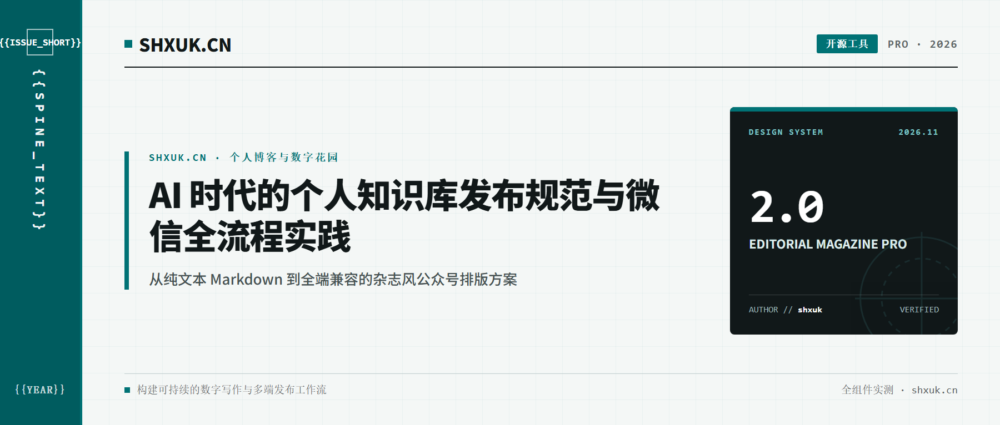
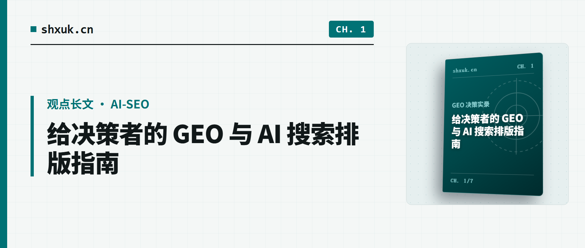

# wechat-article-publisher

简体中文 | [English](./README.en.md)

写微信公众号文章最烦的几件事：Markdown 粘进去格式全乱、想做个折叠块微信又不支持 JS、每次发文都要打开设计软件给头图加标题、改个错别字重传草稿箱又多出一堆冗余草稿。

这个工具专门解决这些琐事。**你只管写纯 Markdown**，剩下的交给它：从纯内联 HTML 转换、双层 SVG 半透明渐隐折叠、自动化杂志级 2.35:1 高清头图合成与 1:1 智能安全区裁切，到微信草稿箱的原地幂等更新。

---

## 视觉与组件展示 (Showcase)

本项目内置**编辑部风 2.0 杂志级排版规范**，针对移动端（390px~430px）阅读习惯深度优化：

### 1. 移动端全组件实机渲染

<div align="center">
  
</div>

- **刊头引流与导读条 (`::: kicker`)**：支持系列章节标号与博客/站点自然语言导流。
- **极简结论先行区 (`::: lead`)**：深墨青底色、白字加粗直出核心观点（「字多不看」）。
- **原生双栏数字页签 (`## 01`)**：纯 `<table>` 布局，告别 CSS Grid/Flex 在微信各端的塌陷掉行。
- **四色标准提示块 (`TIP` / `NOTE` / `WARNING` / `IMPORTANT`)**：克制的左竖线与圆角淡底。
- **大数字指标卡 (`::: metrics`)**：大字号关键数据展示，移动端自适应列宽。
- **双轨对比卡 (`::: versus`)**：左右/上下结构化对照，直观展现方案差异。
- **金句判词卡 (`::: verdict`)**：适合章节结尾收口或核心金句提炼。
- **常见问答卡 (`::: qa`)**：一问一答结构化展示，自动生成 `Q01`、`Q02` 编号。
- **双层 SVG 渐隐折叠 (`::: details`)**：原生双层 SVG，未展开时半透明渐隐露出前 3 行，整块点击平滑展开，右下角按钮收起，不触发微信弹窗拦截。
- **开源项目展示 (`::: githubcard` / `::: githubreadme`)**：优雅嵌入 GitHub 仓库信息与核心摘要。
- **作者与文末关注卡 (`::: follow`)**：集成个人品牌（以 `shxuk.cn` 为官方范本）与公众号交互导流。

---

### 2. 自动化高清头图模板 (Cover Templates)

基于 Chrome/Edge 本地无头渲染引擎，自动从 Markdown Frontmatter 提取标题、副标题、章节号与统计数据，毫秒级合成 1800×766 高清头图，并自动计算注入微信 1:1 正方形裁切坐标（避免列表页标题被硬生生腰斩）：

#### 模板 D：编辑部专题 Pro 封面 (`template-d.html`)
> 左侧书脊 + 顶部品牌标 + 大标题与副文本 + 右侧 1:1 安全区核心数据徽章（支持 `shxuk.cn` 独立域名角标）

<div align="center">
  
</div>

#### 模板 E：3D 几何立体专著/工具封面 (`template-e.html`)
> 专著质感 + 墨青/墨蓝/墨黑/暖米四色调色板 + 空间网格投影 + 右侧 1:1 大字安全区

<div align="center">
  
</div>

---

## 组件语法速查

全部组件均在 `templates/editorial.md` 与 `docs/样例/geo-editorial-case.md` 中提供完整实例文档：

| 组件类型 | Markdown 语法示例 | 适用场景 |
| --- | --- | --- |
| **顶部刊头** | `::: kicker 栏目名 · CH. 1/7 \| AI搜索我的博客：shxuk.cn让AI帮你总结全文 :::` | 文首第一屏，标明系列与品牌导读 |
| **结论导读** | `::: lead[字多不看：]`<br>`**核心观点加粗直出**`<br>`:::` | 文首快速抓住读者眼球 |
| **数字章节** | `## 01 章节标题` | 自动渲染为墨青方块标签双栏标题 |
| **小节标题** | `### 左竖线小节标题` | 正文小节切分 |
| **四色提示块** | `> TIP 提示内容` 或 `::: tip[标题]` | 技巧、注释、警示、重要注意事项 |
| **大数字指标** | `::: metrics[指标标题]`<br>`82% \| 传统点击衰减 \| 详细说明`<br>`:::` | 关键数据看板展示 |
| **双轨对照** | `::: versus[A vs B]`<br>`方案A优缺点`<br>`---`<br>`方案B优缺点`<br>`:::` | 架构选型、新旧范式对比 |
| **金句判词** | `::: verdict[核心结论]`<br>`这是最核心的一句话`<br>`:::` | 段落总结收口 |
| **问答卡组** | `::: qa[核心问答]`<br>`Q: 问题？`<br>`A: 回答`<br>`:::` | 常见误区解答、FAQ 模块 |
| **半透明折叠** | `::: details[展开查看代码与附录]`<br>`折叠内容...`<br>`:::` | 长表格、附录、代码块（双层 SVG） |
| **GitHub卡片**| `::: githubcard shxuk/wechat-article-publisher :::` | 开源项目引流 |
| **文末关注卡**| `::: follow[shxuk.cn \| 个人博客]`<br>`1. 关注我...`<br>`:::` | 个人主页与粉丝沉淀 |

---

## 快速上手

### 1. 安装环境

```bash
# 安装原生轻量依赖（markdown-it + juice 原生内联）
pnpm install
```

### 2. 本地渲染预览（免微信凭证）

```bash
# 渲染标准组件模版
node scripts/wechat.mjs gen templates/editorial.md

# 渲染 GEO 深度专题实战案例
node scripts/wechat.mjs gen docs/样例/geo-editorial-case.md
```

产物生成在工作目录（默认 `~/.wechat-article/work/<文章名>/` 或通过 `WECHAT_WORK_DIR` 指定）：
- `body.html`：可直接复制到微信公众号编辑器、富文本客户端的纯内联样式 HTML。
- `layout.json`：排版规则命中记录与样式诊断数据。
- `meta.json`：提取的封面、标题、摘要及 SVG 折叠高度统计。

### 3. 一键推送到微信草稿箱（幂等更新）

```bash
# 复制环境变量模板
cp .env.example .env

# 配置你的公众号凭证
# WECHAT_APP_ID=wx...
# WECHAT_APP_SECRET=...

# 推送文章（自动处理图片上传、合成头图、创建或原地更新对应草稿）
node scripts/wechat.mjs push templates/editorial.md
```

---

## 品牌与生态定制

本项目以作者个人主页 `shxuk.cn` 及 GitHub `shxuk` 作为默认展示规范，你也可以通过环境变量自由替换为你自己的品牌：

```bash
WECHAT_BRAND="SHXUK.CN"         # 头图与卡片默认品牌词
WECHAT_SITE_DOMAIN="shxuk.cn"   # 头图与关注卡中的展示域名
WECHAT_CHROME="path/to/chrome"  # 可选：显式指定 Chrome/Edge 路径
```

---

## 仓库结构

- `scripts/wechat.mjs`：核心 CLI（`gen` 本地渲染 / `push` 推送草稿 / Chrome 无头头图合成）
- `scripts/build-preview.mjs`：自动化组件长图与头图截图构建脚本
- `components/`：组件层，`cards.mjs`（全套杂志风卡片）与 `svg-fold.mjs`（双层半透明 SVG 渐隐折叠）
- `assets/`：样式主题 `theme.css`、组件预览图、头图模板底图
- `templates/`：官方标准模板 `editorial.md` 及高清头图 HTML 模板（`template-a` ~ `template-e`）
- `docs/样例/`：包含 `geo-editorial-case.md` 实战案例与历史排版设计规范
- `SKILL.md`：给 AI Agent 调用的完整技能说明

---

## 开源协议

本项目采用 [MIT License](./LICENSE) 开源协议。
